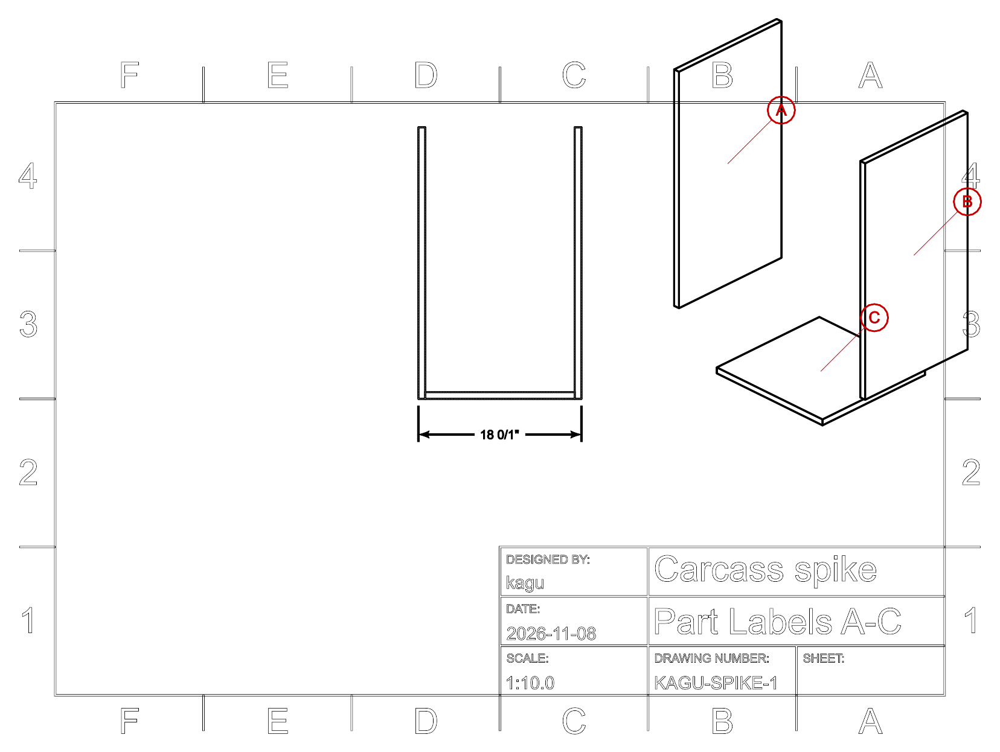

# Code-CAD shop drawings and assembly annotation

Research for [#2](https://github.com/uf-cpe-design-lab/kagu/issues/2) on the map [#1](https://github.com/uf-cpe-design-lab/kagu/issues/1). Researched 2026-11-08 against build123d 0.13.0, CadQuery 2.8.0, ocp-vscode 4.2.0, FreeCAD 1.1.4, `@google/model-viewer` 4.4.0 and three-cad-viewer 5.1.3. Claims marked **(verified)** were run in a throwaway spike ([`code-cad-drawings/spike.py`](code-cad-drawings/spike.py)) or read in the released source. The rest come from the official docs linked in [Sources](#sources).

## Answer

**Use build123d for everything, including the drawings.** Of the code-first tools, only build123d has dimensioning in its design source. Its `drafting` module has `Draft`, `ExtensionLine`, `DimensionLine`, `Arrow` and `TechnicalDrawing`. It also has hidden-line projection (`project_to_viewport`, renamed `drawing_view` on the dev branch), `section()`, and layered `ExportSVG` / `ExportDXF` exporters. The 3D exporters cover STEP, STL, glTF/GLB and 3MF (`Mesher`). A shape's `label` carries through to the STEP product name, the glTF node name and the 3MF part number **(verified)**, so it can serve as the Part Label everywhere from one attribute.

The drawing layer is **workable but young**. It has no balloon/leader class, no PDF writer and no layout engine: you place each view and dimension by coordinates. Title-block text is outlined geometry, not real text. Fractional-inch dimensions have a display bug. A small in-repo helper module of roughly 200–400 lines fills these gaps: balloons, sheet layout, a fraction formatter, a cut-list table, and SVG→PDF. That's the recommended path.

**Interactive 3D:** use `ocp_vscode` while modeling. To publish a view, export a GLB with `export_gltf` and wrap it in a static HTML page using Google's `<model-viewer>`. Part Labels become hotspots, and an assembled/exploded toggle swaps between two GLBs. three-cad-viewer gives a richer CAD-style web view (tree, explode slider, clipping, measure), but there's no supported exporter feeding it, so it's a stretch option.

**FreeCAD TechDraw via STEP** is the most mature drawing system on the list: real balloons, BOM tables from a spreadsheet, section and detail views. Use it only as a fallback. It breaks the "everything in the design source" goal, dimensions bind to sub-element names that a re-imported STEP can renumber, and PDF export is GUI-only. **CadQuery adds nothing for drawings.** It has SVG/DXF projection but no dimensions. OpenSCAD, replicad and Zoo KCL don't qualify either.

## Comparison

| Capability | build123d 0.13 (native) | build123d → STEP → FreeCAD 1.1 TechDraw | CadQuery 2.8 | OpenSCAD | replicad (JS) | Zoo KCL |
|---|---|---|---|---|---|---|
| Orthographic views with hidden-line removal | Yes: `project_to_viewport` returns visible and hidden edges **(verified)** | Yes: `DrawProjGroup`, `DrawViewPart` | Yes: SVG export with `projectionDir`, `showHidden` | `projection()` silhouette only, no HLR | `drawProjection` (no hidden-line option documented) | No (DXF of sketches only) |
| Section views | `section()` gives 2D faces; you add hatching and placement yourself **(verified)** | Yes: `DrawViewSection` with hatching; detail views | `section()` for DXF | `projection(cut=true)` | Not documented | No |
| Dimensions authored in source | Yes: `ExtensionLine`, `DimensionLine`, `Draft` (mm/inch, decimal/fraction, tolerances) **(verified)** | Yes: `makeDistanceDim`, `makeExtentDim` (Python), bound to edge names | **No** | No | No (measure functions only) | Sketch constraints only |
| Balloons / leaders (Part Labels) | **No class.** Compose from `Circle` + `Text` + `Edge` (about 10 lines) **(verified)** | Yes: `DrawViewBalloon` (Text, BubbleShape, Origin), `makeLeader` | No | No | No | No |
| Title block / sheet | `TechnicalDrawing` (A-series, Letter, Legal, Ledger); fixed layout | Yes: SVG templates | No | No | No | No |
| Exploded views | DIY: move labeled parts by explode vectors, then project **(verified)** | Assembly WB "Exploded View" (native FreeCAD assemblies only, not STEP) | DIY | DIY | DIY | DIY |
| Cut list / BOM | DIY from part data (bounding boxes, labels) **(verified)** | `DrawViewSpreadsheet` and Assembly BOM (data comes from the FreeCAD doc) | DIY | DIY | DIY | No |
| 2D output | SVG, DXF (layers, line types); **no PDF** | SVG, DXF (`writeDXFPage`), PDF (`TechDrawGui.exportPageAsPdf`, GUI only) | SVG, DXF | DXF, SVG | SVG | DXF |
| 3D output | STEP, STL, glTF/GLB, 3MF, OBJ, BREP | Anything FreeCAD exports | STEP, STL, 3MF, glTF (assemblies), VRML, TJS | STL, 3MF, etc. | STEP, STL | STEP, glTF, STL, etc. |
| Part Label carried to 3D files | `shape.label` → STEP PRODUCT, glTF node name, 3MF part_number **(verified)** | Imported STEP product names become object labels | Assembly names | No | No | n/a |
| Interactive 3D | `ocp_vscode` (VS Code / standalone `ocp_viewer`); publish as GLB | FreeCAD GUI | `ocp_vscode`, CQ-editor | Desktop GUI | Browser workbench | Browser app |
| Maturity for shop drawings | Medium-low: works, single maintainer-led, drafting API still being renamed (`drawing_view`) and ISO conventions an open issue (#1314) | High (TechDraw is long-lived), but STEP round-trip is fragile | Low (no annotation) | Low | Low | Low |

## Pipeline sketches

All snippets target **build123d 0.13.0** (Python ≥3.11, <3.15). On the dev branch, `project_to_viewport` is deprecated in favor of `drawing_view(viewpoint, up, look_at, focus)`, which has the same arguments. Pin the version.

### 1. Parts carry their Part Label

```python
from build123d import *

T = 0.75 * IN          # ply thickness: a parameter, measure actual stock
W, D, H = 18 * IN, 16 * IN, 30 * IN

def panel(label, size, loc, explode):
    p = Box(*size)
    p.label = label            # Part Label → STEP product, glTF node, 3MF part_number
    p.color = Color(0xD8B98A)
    p.location = loc
    p.explode = Vector(explode)  # plain Python attribute, used by the exploded view
    return p

A = panel("A", (T, D, H), Location((-(W - T) / 2, 0, H / 2)), (-150, 0, 0))
B = panel("B", (T, D, H), Location(( (W - T) / 2, 0, H / 2)), ( 150, 0, 0))
C = panel("C", (W - 2*T, D, T), Location((0, 0, T / 2)),      (0, 0, -150))
carcass = Compound(label="Carcass", children=[A, B, C])
```

### 2. Exploded view (3D and 2D)

```python
exploded = Compound(label="Carcass-exploded",
                    children=[p.moved(Location(p.explode)) for p in carcass.children])
# moved() keeps .label (verified); the custom .explode attribute is only read here
```

The same `exploded` compound goes to the drawing (iso projection below) and to a second GLB for the web view. Assembly order can be shown as a sequence of partial exploded compounds, one sheet per step.

### 3. Dimensioned orthographic sheet

```python
scale = 0.1
def view(shape, viewpoint, up=(0, 0, 1)):
    vis, hid = shape.project_to_viewport(viewpoint, up, look_at=(0, 0, 0))
    return Compound(children=vis).scale(scale), Compound(children=hid).scale(scale)

front_vis, front_hid = view(carcass, (0, -1000, 0))
iso_vis, _          = view(exploded, (1000, -1000, 800))
iso_vis = iso_vis.moved(Location((90, 20)))             # manual layout

draft = Draft(font_size=3.5, unit=Unit.IN, number_display=NumberDisplay.FRACTION,
              fractional_precision=32)
bb = front_vis.bounding_box()
width_dim = ExtensionLine(border=[(bb.min.X, bb.min.Y), (bb.max.X, bb.min.Y)],
                          offset=(0, -10), draft=draft,
                          label=fmt_in(W))   # fmt_in = kagu fraction formatter; pass the TRUE size (Gaps #2, #3)

sheet = TechnicalDrawing(page_size=PageSize.LETTER, title="Carcass", sub_title="Sheet 1",
                         drawing_number="KAGU-C-1", drawing_scale=1/scale, designed_by="kagu")

svg = ExportSVG(unit=Unit.MM, margin=5)
svg.add_layer("Border", fill_color=(0, 0, 0))            # fill so outlined text reads solid
svg.add_layer("Visible", line_weight=0.5)
svg.add_layer("Hidden", line_color=(99, 99, 99), line_type=LineType.ISO_DOT)
svg.add_layer("Dims", fill_color=(0, 0, 0), line_weight=0.2)
svg.add_layer("Labels", fill_color=(200, 0, 0), line_color=(200, 0, 0))
for shape, layer in [(sheet, "Border"), (front_vis, "Visible"), (front_hid, "Hidden"),
                     (iso_vis, "Visible"), (width_dim, "Dims")]:
    svg.add_shape(shape, layer=layer)
svg.write("carcass-1.svg")
# Same shapes into ExportDXF(unit=Unit.MM) with add_layer/add_shape → carcass-1.dxf
```

Sections: `section(carcass, section_by=Plane.XZ)` returns the cut faces. Move them onto the sheet and add hatching yourself (for example, a clipped line pattern). There's no hatch helper.

### 4. Part Label balloons

There's no balloon class, so compose one. Anchor each leader at the part's centroid, projected through the same viewport as the view it labels:

```python
def balloon(letter, anchor, at, r=4.0):
    ring = Pos(at.X, at.Y) * (Circle(r) - Circle(r - 0.35))
    text = Pos(at.X, at.Y) * Text(letter, font_size=4.5)
    leader = Edge.make_line(at + (anchor - at).normalized() * r, anchor)
    return ring + text, leader

def project_point(p3, viewpoint, up=(0, 0, 1)):
    tick = Edge.make_line(p3, p3 + Vector(0.01, 0, 0))     # HLR needs an edge, not a vertex
    vis, _ = Compound(children=[tick]).project_to_viewport(viewpoint, up, look_at=(0, 0, 0))
    return vis[0].position_at(0) * scale + Vector(90, 20)   # same scale and offset as iso_vis

for p in exploded.children:
    a = project_point(p.center(), (1000, -1000, 800))
    ring_and_text, leader = balloon(p.label, a, a + Vector(15, 15))
    svg.add_shape(ring_and_text, layer="Labels"); svg.add_shape(leader, layer="Labels")
```

Result of the spike (Letter sheet, front view with an overall dimension, exploded iso with balloons A–C):



The overall dimension in the spike reads `18 0/1"`. That's the fraction bug in Gaps #3.

To mark **orientation**, add a second glyph to the balloon, such as an arrow or cabinetmaker's triangle drawn on the face the label is written on. Or model a small "label face" marker on each part (a thin `Box` on the reference face) and let it project into every view.

### 5. Cut list

```python
import csv
with open("cutlist.csv", "w", newline="") as f:
    w = csv.writer(f); w.writerow(["Part Label", "L (in)", "W (in)", "T (in)", "Qty"])
    for p in carcass.children:
        L, Wd, Th = sorted(p.bounding_box().size, reverse=True)
        w.writerow([p.label, L / IN, Wd / IN, Th / IN, 1])
```

**(verified)** The spike printed `A,30.0,16.0,0.75`, `B,…` and `C,16.5,16.0,0.75`. Bounding boxes only work for rectangular stock in its home orientation. Store real cut-list data on each part instead: finished L×W, grain direction, edge banding, material, and whether it's a printed part. Render that same data as a table on the sheet (a grid of `Text` + lines; there's no table helper).

### 6. Printed parts carry their label physically

Emboss or deboss the Part Label in the model, e.g. `extrude(Text("K", 6), amount=-0.6, mode=Mode.SUBTRACT)` on a hidden face, and name the 3MF object:

```python
m = Mesher(); m.add_shape(K, part_number="K"); m.write("K.3mf")   # verified
export_stl(K, "K.stl")
```

### 7. Interactive 3D on the web

```python
export_gltf(carcass,  "web/carcass.glb", binary=True)            # verified: nodes Carcass, A, B, C
export_gltf(exploded, "web/carcass_exploded.glb", binary=True)
```

```html
<script type="module"
  src="https://cdn.jsdelivr.net/npm/@google/model-viewer@4.4.0/dist/model-viewer.min.js"></script>
<model-viewer id="mv" src="carcass.glb" camera-controls style="width:100%;height:80vh">
  <!-- glTF is Y-up in metres: build123d (x, y, z) mm → (x/1000, z/1000, -y/1000) -->
  <button slot="hotspot-A" data-position="-0.219 0.381 0" data-normal="-1 0 0">A</button>
  <button slot="hotspot-B" data-position="0.219 0.381 0"  data-normal="1 0 0">B</button>
</model-viewer>
<button onclick="mv.src = mv.src.includes('exploded') ? 'carcass.glb' : 'carcass_exploded.glb'">
  Explode / assemble</button>
```

Generate the hotspot coordinates in Python from each part's `center()`, so labels stay in sync with the parameters. Host the page on GitHub Pages or attach it to a ticket. Two **verified** facts make a richer page easy:

- `export_gltf` writes each labeled part as a named node with its own translation.
- A three.js page (`three@0.187.0`) can therefore find node `"A"` and animate `node.position` along its explode vector with a slider. That needs about 40 lines of JS and no second GLB.

**Stretch:** `ocp_viewer_core.offline._convert(...)` tessellates build123d objects without a running viewer into the JSON that three-cad-viewer renders **(verified it runs)**. Fed to `three-cad-viewer@5.1.3` in a static page, this gives the same tree, explode, clipping and measure UI as ocp_vscode. However, `_convert` is private ("Private on purpose" in its docstring), and the viewer docs list no HTML or scene exporter. The only documented export is `save_screenshot` to PNG. Treat this route as unsupported.

**Fallback:** GitHub renders committed `.stl` files in an interactive viewer and offers an embed script. That's a single mesh with no colors or labels.

### 8. FreeCAD TechDraw fallback (if native drawings prove too slow to author)

`export_step(carcass, "carcass.step")` keeps the labels as product names **(verified)**. In FreeCAD 1.1.4 the following are App-module objects and functions, so in principle they're scriptable from headless `FreeCADCmd` (untested here):

- `DrawPage` holds the sheet and `DrawProjGroup` the orthographic views.
- `DrawViewSection` and `DrawViewDetail` give sections and details.
- `TechDraw.makeDistanceDim(view, type, from, to)` adds dimensions between 2D view points, and `makeDistanceDim3d` does the same from 3D model points, so build123d can supply them.
- `DrawViewBalloon` adds balloons: `SourceView`, `Text` (the Part Label), `BubbleShape`, `OriginX/Y`. The origin is a 2D point, so build123d can compute it as in §4.
- `DrawViewSpreadsheet` adds a cut-list table.
- `TechDraw.writeDXFPage(page, path)` writes DXF.

PDF and SVG page export (`TechDrawGui.exportPageAsPdf` / `exportPageAsSvg`) live in **TechDrawGui** and need a GUI session.

## Gaps and workarounds

1. **No balloon/leader/callout object** in build123d (none in 0.13.0 or on dev; no upstream issue found). *Workaround:* the ~10-line helper in §4, kept in a kagu drafting module.
2. **Dimensions measure the drawing, not the model.** `ExtensionLine` labels the length of the path it's given, which after view scaling is the scaled length: the spike's 18″ panel measured `45.72` mm on a 1:10 sheet. *Workaround:* always pass `label=` formatted from the model parameter, which also gives parameter-driven labels for free. Alternatively, build the views at 1:1, dimension them, then scale the whole sheet compound. Font sizes then have to be specified pre-scale.
3. **Fractional-inch display bug** (0.13.0 and dev): whole numbers render as `18 0/1"`, and values that round up to the next inch render as `17 1/1"` (17.999″) **(verified)**. The cause is `Draft._number_with_units`, which never drops a zero or full numerator. *Workaround:* format labels with a kagu helper. Worth a small upstream PR.
4. **No PDF output.** *Workaround:* the SVG is written in true mm (`width="…mm"`). Convert each sheet with rsvg-convert, CairoSVG or Inkscape's CLI, merge with pypdf, and check 1:1 print scale on the first sheet.
5. **The SVG page is the content bounding box plus margin, not the paper size** (Letter came out 280×211 mm), and `TechnicalDrawing` sizes its frame from page width only (height = 2/3 width). *Workaround:* add an invisible paper-sized rectangle, or write a kagu sheet/title-block helper.
6. **Text is outlined geometry**, not SVG `<text>` or DXF TEXT/DIMENSION entities **(verified: 0 TEXT, 0 DIMENSION in the DXF)**. The DXF opens fine for viewing, but dimensions aren't editable as dimensions in a DXF tool. Not a problem when everything is regenerated from code.
7. **No automatic view layout, hatching or tables.** Each view is placed by `moved(Location(...))`. *Workaround:* a small layout helper (a grid of view slots per sheet) and a table helper.
8. **API churn.** `project_to_viewport` is deprecated on dev in favor of `drawing_view`; an ISO-conventions issue (#1314) is open. Releases came at 0.11 (Jun 2026), 0.12 and 0.13 (Sep 2026). *Workaround:* pin `build123d==0.13.*` and confine drafting calls to one kagu module.
9. **Exploded views and assembly sequences are entirely DIY.** build123d has `joints` for positioning but no explode or step concept. *Workaround:* an explode vector per part plus an ordered list of steps per assembly. Each step renders one sheet and one GLB.
10. **FreeCAD STEP round-trip is not associative.** TechDraw dimensions reference sub-element names (e.g. `Edge12`). Re-importing a regenerated STEP can renumber them, and FreeCAD's toponaming mitigation targets its own PartDesign features, not imported solids. Point-based `makeDistanceDim3d` may avoid edge references, but balloons, views and the STEP link would still need rebuilding by script on every change. This is inferred from TechDraw's reference model and not tested here. It's the main reason to keep TechDraw as a fallback.

## Implications for kagu

- **Part Label = `shape.label`**, set in exactly one place per part. Cut list, drawing balloons, STEP, GLB node names, 3MF names and embossed printed-part text all read from it, so a part can't be mislabeled in one output and not another.
- **Plan a `kagu.drafting` module** in the CAD effort, owning:
  - sheet and title block (Letter or Ledger, sized to whatever the lab prints);
  - view layout slots;
  - a parameter-driven dimension helper with an inch-fraction formatter;
  - the balloon with orientation glyph;
  - the cut-list table;
  - a hatch for sections;
  - SVG→PDF.

  Each part module then only declares *what* to show.
- **Each part also carries cut-list data** (finished size, grain direction, edge treatment, material/stock, count) as plain Python data. Drawings and the CSV are generated from it, not measured from geometry.
- **Assembly guides fall out of the same data.** An ordered list of steps (which Part Labels are added, plus explode vectors) yields one exploded sheet per step for the paper guide, and one GLB pair or a slider page for the web.
- **Illustrating decisions on tickets** is cheap. Any prototype can `export_gltf` and drop a model-viewer page, and `ocp_vscode.save_screenshot` gives the PNG for the ticket body.
- **Shop-drawing units:** `Draft` supports fractional inches natively, so 3/4″ ply and imperial shop tools are fine once Gap #3 is worked around. Actual ply thickness stays a parameter, and the labels show whatever was measured.
- **No CNC means DXF matters less.** SVG/PDF sheets for the assistant are the primary 2D output. DXF is still worth emitting for anyone laying out 3D-printed drilling jigs or templates in other tools.

## Open questions surfaced

- Units on the shop drawings: fractional inches (matches tape, fence and ply) or mm (matches printed parts and gridfinity's 42 mm grid)? Possibly dual-dimensioned.
- Where interactive views live: GitHub Pages on the kagu repo, ticket attachments, or both.
- Sheet-goods nesting / cut optimization (4×8 sheets) wasn't researched. Generate cut layouts in code, or hand the cut list to an external optimizer?
- The physical Part Label convention: which face, which corner, and what mark shows orientation (triangle, arrow, "UP/FRONT").
- Paper size the lab can print: Letter only, or Ledger/11×17?

## Sources

- build123d on PyPI: 0.13.0, released 2026-09-21, Python ≥3.11 <3.15. https://pypi.org/project/build123d/
- build123d releases (v0.11.0 2026-06-17, v0.12.0 2026-09-18, v0.13.0 2026-09-21): https://github.com/gumyr/build123d/releases
- build123d `drafting.py` (Draft, DimensionLine, ExtensionLine, TechnicalDrawing; fraction formatting): https://github.com/gumyr/build123d/blob/v0.13.0/src/build123d/drafting.py
- build123d `exporters.py` (Drawing HLR, ExportSVG, ExportDXF): https://github.com/gumyr/build123d/blob/v0.13.0/src/build123d/exporters.py
- build123d `exporters3d.py` (`_create_xde` label → name, `export_gltf`, `export_step`): https://github.com/gumyr/build123d/blob/v0.13.0/src/build123d/exporters3d.py
- build123d `mesher.py` (3MF): https://github.com/gumyr/build123d/blob/v0.13.0/src/build123d/mesher.py
- build123d dev `composite.py` (`drawing_view`, `project_to_viewport` deprecated): https://github.com/gumyr/build123d/blob/dev/src/build123d/topology/composite.py
- build123d technical drawing tutorial: https://build123d.readthedocs.io/en/latest/tech_drawing_tutorial.html
- build123d import/export docs: https://build123d.readthedocs.io/en/latest/import_export.html
- build123d issue #1314, "ISO Standards for technical drawings" (open): https://github.com/gumyr/build123d/issues/1314
- CadQuery import/export docs: https://cadquery.readthedocs.io/en/latest/importexport.html
- CadQuery v2.8.0 release (2026-06-20): https://github.com/CadQuery/cadquery/releases
- OCP CAD Viewer (ocp-vscode 4.2.0, 2026-10-13) README: https://github.com/bernhard-42/vscode-ocp-cad-viewer
- OCP viewer Python API docs (`save_screenshot` only export): https://bernhard-42.github.io/ocp_viewer_docs/api/
- three-cad-viewer (npm 5.1.3, 2026-10-12): https://github.com/bernhard-42/three-cad-viewer
- FreeCAD 1.1.4 release (2026-09-28): https://github.com/FreeCAD/FreeCAD/releases/tag/1.1.4
- FreeCAD TechDraw App Python module (`makeDistanceDim`, `writeDXFPage`, `makeLeader`): https://github.com/FreeCAD/FreeCAD/blob/1.1.4/src/Mod/TechDraw/App/AppTechDrawPy.cpp
- FreeCAD TechDrawGui Python module (`exportPageAsPdf`, `exportPageAsSvg`): https://github.com/FreeCAD/FreeCAD/blob/1.1.4/src/Mod/TechDraw/Gui/AppTechDrawGuiPy.cpp
- FreeCAD `DrawViewBalloon.h` (balloon properties): https://github.com/FreeCAD/FreeCAD/blob/1.1.4/src/Mod/TechDraw/App/DrawViewBalloon.h
- FreeCAD Assembly exploded view command: https://github.com/FreeCAD/FreeCAD/blob/1.1.4/src/Mod/Assembly/CommandCreateView.py
- model-viewer annotations/hotspots (npm `@google/model-viewer` 4.4.0, 2026-10-09): https://modelviewer.dev/examples/annotations/
- GitHub docs, working with non-code files (STL viewer, SVG, PDF rendering): https://docs.github.com/en/repositories/working-with-files/using-files/working-with-non-code-files
- OpenSCAD 3D-to-2D projection: https://en.wikibooks.org/wiki/OpenSCAD_User_Manual/3D_to_2D_Projection
- replicad API index: https://replicad.xyz/docs/api/
- Zoo Design Studio DXF export: https://zoo.dev/docs/zoo-design-studio/features/data-management/export/export-dxf
